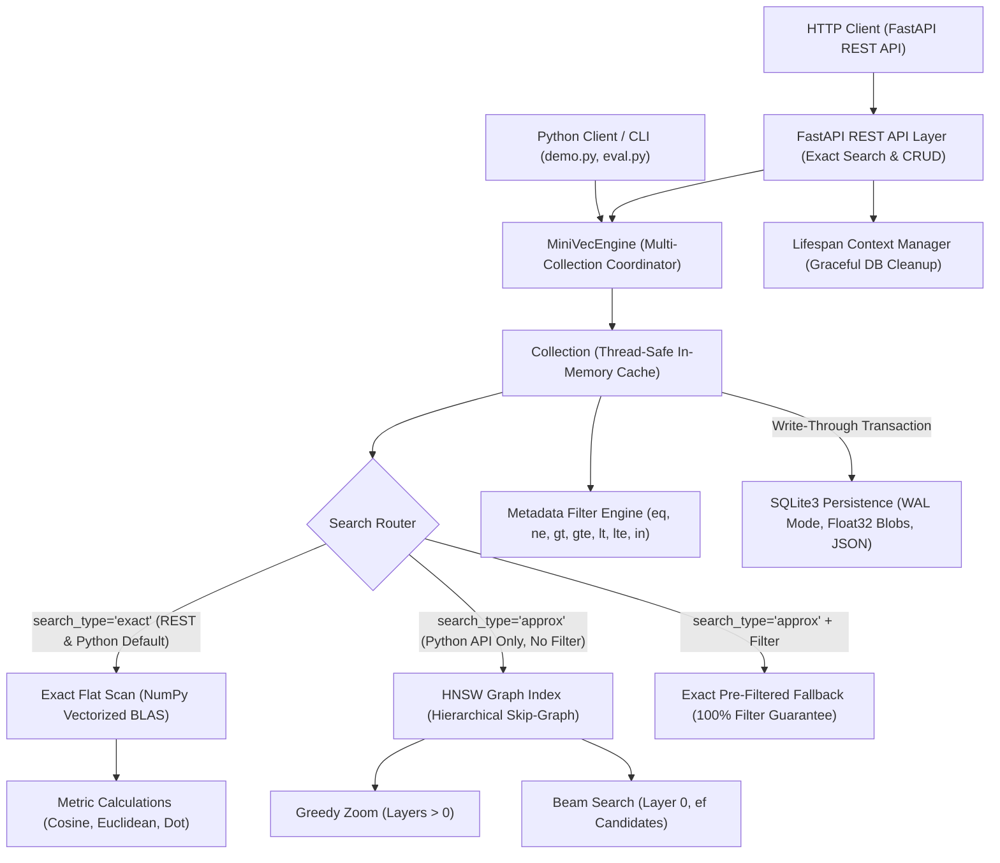

# MiniVec

**MiniVec** is an independent, first-principles vector search engine and database built in Python. Designed for educational study and portfolio demonstration, it demystifies how modern vector databases (such as Qdrant, Milvus, and Pinecone) store high-dimensional embeddings, execute exact and graph-based approximate similarity searches, filter metadata payloads, and use SQLite WAL and atomic transactions for durable persistence, using SQLite Write-Ahead Logging (WAL).

---

## 💡 Background & Attribution

During Phase 2 (Project Design), core vector database paradigms were studied by referencing the open-source [Qdrant](https://github.com/qdrant/qdrant) project. MiniVec translates those distributed concepts into an accessible, educational Python implementation.

> **Notice:** MiniVec is an independent educational project for portfolio demonstration and systems study. It does not contain code from Qdrant and is not a drop-in replacement for production-grade distributed vector search engines. See [NOTICE](NOTICE) for full attribution details.

---

## 🏛️ System Architecture

MiniVec uses a layered, thread-safe architecture that separates REST routing, multi-collection lifecycle management, in-memory vector storage, graph indexing, and durable on-disk persistence:



> **Interface Distinction (REST API vs. Python API):**
> - **REST API (`/collections/{name}/search`)**: Exposes collection management, point upsert/retrieval, and **exact vector similarity search** with metadata filtering over HTTP.
> - **Python API (`Collection`)**: Exposes the complete engine feature set, including building metric-specific HNSW indices (`col.create_index()`), running approximate graph searches (`col.search(..., search_type="approx")`), and running benchmark evaluations.

---

## 🛠️ Technology Stack

- **Python**: 3.11+ (verified on Python 3.12.14)
- **FastAPI & Uvicorn**: Asynchronous REST API framework with Swagger UI documentation
- **NumPy**: Vectorized linear algebra operations and distance calculations (Cosine, Dot Product, Euclidean)
- **Pydantic v2**: Request/response serialization, resource safety bounds, and type-safe configuration
- **SQLite3**: Python standard library storage engine with Write-Ahead Logging (WAL) and atomic transactions
- **pytest & httpx**: Automated test harness covering unit, integration, persistence, and concurrency tests
- **uv**: Deterministic package and virtual environment management via `uv.lock`

---

## 🗺️ Roadmap & Milestones

- [x] **Milestone 0: Project Scaffolding & Environment Setup**
  - Declarative configuration via `pyproject.toml`
  - Deterministic dependency locking via `uv.lock`
  - Baseline test harness with `pytest`
- [x] **Milestone 1: Vector Storage & Validation**
  - High-dimensional vector representation with float32 NumPy arrays
  - Dimension consistency validation, NaN/Inf checks, and defensive data copying
- [x] **Milestone 2: Exact Similarity Search**
  - Vectorized Cosine similarity, Dot product, and Euclidean distance
  - Deterministic tie-breaking by point ID
  - Top-$k$ ranking algorithms
- [x] **Milestone 3: Metadata Filtering (Payloads)**
  - Schema-less payload filtering (`eq`, `ne`, `gt`, `gte`, `lt`, `lte`, `in`)
  - Efficient pre-filtering strategy combined with boolean AND semantics
- [x] **Milestone 4: REST API with FastAPI**
  - Clean REST endpoints for collection lifecycle, point upsert, and vector search
  - Strict Pydantic validation and consistent HTTP error mapping
  - Isolated test client architecture with multi-instance engine support
- [x] **Milestone 5: SQLite Persistence**
  - Python `sqlite3` storage engine with Write-Ahead Logging (WAL)
  - Normalized schema (`collections` and `points`) with foreign keys
  - Exact float32 binary vector serialization and JSON payload storage
  - Crash resilience, automatic cold-start hydration, and rollback safety
- [x] **Milestone 6: Reliability, Logging, and Security Hardening**
  - Database lifecycle management via FastAPI `@asynccontextmanager` lifespan
  - Fine-grained thread synchronization (`threading.RLock`) for collections, storage, and engine
  - Configurable resource safety bounds (`max_vector_dimension`, `max_search_limit`, `max_payload_bytes`)
  - Sanitized, leak-proof error handling (internal tracebacks and DB paths hidden from clients)
  - Privacy-safe audit logging (logs latencies, point IDs, and operational events without logging raw vector floats or payload data)
- [x] **Milestone 7: Approximate Nearest-Neighbor Search (ANN) & Recall@k Evaluation**
  - Educational pure-Python Hierarchical Navigable Small World (HNSW) index without external ANN libraries
  - Metric-specific graph routing supporting Cosine similarity, Euclidean distance, and Dot product
  - Real-time synchronization of active in-memory indices on new point insertions; durable SQLite persistence for raw vectors and payloads with explicit on-demand index reconstruction via the Python API
  - Filter safety: automatic fallback to exact pre-filtered search when metadata filters are supplied
  - Mathematical Recall@k evaluation module and repeatable benchmarks across synthetic clustered datasets
- [x] **Milestone 8: Portfolio Wrap-up, Reproducible Demo & Project Verification**
  - Standalone deterministic demonstration script (`demo.py`) with zero-leakage temporary database isolation
  - Direct evaluation CLI (`python -m minivec.eval`) reporting empirical Recall@k, latencies, and speedups
  - Comprehensive documentation, Mermaid diagrams, and interview defence notes

---

## ⚙️ Configuration & Environment Variables

MiniVec provides centralized, type-safe configuration via `pydantic.BaseModel` in [src/minivec/config.py](src/minivec/config.py). All settings have sensible defaults and are configured using **operating-system environment variables**.

> **Important:** MiniVec reads environment variables directly from the host operating system (`os.getenv`) and does **not** automatically parse or load a local `.env` file at runtime. The [.env.example](.env.example) file is provided as a reference template.

### Setting Variables in Windows PowerShell
```powershell
# Set variables for the current PowerShell session
$env:PORT = "8000"
$env:LOG_LEVEL = "DEBUG"
$env:DATA_DIR = "./data"

# Verify variable is set
$env:PORT
```
*(On Linux/macOS, use `export PORT=8000`)*

| Variable | Default | Description |
| :--- | :--- | :--- |
| `APP_ENV` | `development` | Deployment environment (`development`, `test`, `production`). |
| `DEBUG` | `true` | Enable debug mode and verbose diagnostic logging. |
| `LOG_LEVEL` | `INFO` | Logging level (`DEBUG`, `INFO`, `WARNING`, `ERROR`, `CRITICAL`). |
| `HOST` | `127.0.0.1` | Host interface for REST API (local-only by default for security). |
| `PORT` | `8000` | Port for the REST API server. |
| `DATA_DIR` | `./data` | Directory where SQLite persistent databases are saved. |
| `DATABASE_NAME` | `minivec.db` | SQLite database filename. |
| `MAX_VECTOR_DIMENSION` | `4096` | Maximum allowed vector dimension per collection. |
| `MAX_SEARCH_LIMIT` | `1000` | Maximum top-$k$ search limit allowed per query. |
| `MAX_PAYLOAD_BYTES` | `65536` | Maximum serialized JSON payload size in bytes (64 KB). |

---

## 🚀 Getting Started (Windows PowerShell)

### Prerequisites

- [uv](https://docs.astral.sh/uv/) installed on your system.
- Python 3.11 or higher (Python 3.12 recommended).

### 1. Environment Setup

Synchronize dependencies and install MiniVec in editable mode:

```powershell
# Create virtual environment and synchronize dependencies from uv.lock
uv sync --locked
```

### 2. Run the Automated Test Suite

Execute the full suite of 214 tests (including unit, persistence, concurrency, HNSW regression, and demo tests):

```powershell
uv run pytest -v
```

### 3. Run the Deterministic Demonstration

Execute the self-contained demonstration script:

```powershell
uv run python demo.py
```

*What the demo does:*
- Creates an isolated temporary SQLite database (completely preserving your development database).
- Ingests 6 product embeddings with metadata payloads.
- Executes exact Cosine similarity search.
- Constructs an HNSW graph index and runs approximate search.
- Executes compound pre-filtered search (`category == 'electronics' AND price <= 300`).
- Reopens the SQLite database from disk to verify crash recovery.

### 4. Run the Recall@k Benchmark CLI

Reproduce empirical Recall@k and query latency metrics across Cosine, Euclidean, and Dot Product metrics:

```powershell
uv run python -m minivec.eval
```

### 5. Starting the REST API Server

Run the development server via Uvicorn:

```powershell
uv run uvicorn minivec.api:app --host 127.0.0.1 --port 8000 --reload
```

Interactive OpenAPI documentation (Swagger UI) is available at:
`http://127.0.0.1:8000/docs`

---

## 💻 API Usage Examples (PowerShell)

### Health Check
```powershell
Invoke-RestMethod -Uri "http://127.0.0.1:8000/health" -Method Get
```

### Create a Collection
```powershell
$body = @{ name = "products"; dimension = 4 } | ConvertTo-Json
Invoke-RestMethod -Uri "http://127.0.0.1:8000/collections" -Method Post -Body $body -ContentType "application/json"
```

### Insert Points with Metadata
```powershell
$point = @{
    id = "prod-101"
    vector = @(0.95, 0.10, 0.05, 0.00)
    payload = @{ title = "Headphones"; category = "electronics"; price = 249.99; in_stock = $true }
} | ConvertTo-Json
Invoke-RestMethod -Uri "http://127.0.0.1:8000/collections/products/points" -Method Post -Body $point -ContentType "application/json"
```

### Exact & Filtered Vector Search
```powershell
$searchQuery = @{
    query = @(0.92, 0.12, 0.06, 0.01)
    limit = 3
    metric = "cosine"
    filter = @{
        must = @(
            @{ key = "category"; operator = "eq"; value = "electronics" },
            @{ key = "price"; operator = "lte"; value = 300.0 }
        )
    }
    with_payload = $true
} | ConvertTo-Json -Depth 5
Invoke-RestMethod -Uri "http://127.0.0.1:8000/collections/products/search" -Method Post -Body $searchQuery -ContentType "application/json"
```

---

## ⚡ Approximate Nearest-Neighbor (HNSW) & Recall@k

MiniVec implements an educational, pure-Python version of the **Hierarchical Navigable Small World (HNSW)** algorithm ([src/minivec/hnsw.py](src/minivec/hnsw.py)) based on Malkov & Yashunin (2018).

### 1. Key Algorithmic Concepts

- **Multi-Layer Skip-Graph**: Vectors are assigned a maximum layer $l = \lfloor -\ln(U) \cdot m_L \rfloor$. Layer 0 contains all points with dense local links. Higher layers contain exponentially fewer nodes, serving as expressways for rapid coarse-grained routing across high-dimensional space.
- **Upper-Layer Insertion Invariant**: When an inserted node receives a level $L$ higher than the current `max_layer`, its adjacency list `layers[l][point_id] = []` is explicitly initialized across every elevated layer $l \in (\text{old\_max\_layer}, L]$. Because it is initially the sole node on those upper layers, its neighbor list starts empty, and it is safely promoted to `entry_point`. This guarantees that `entry_point in layers[max_layer]` always holds, degree bounds remain valid, and subsequent nodes on elevated layers can discover and bidirectionally connect to it.
- **In-Memory Lifecycle & Persistence Distinction**: SQLite persistence stores raw vectors, point IDs, and JSON payloads durably on disk. HNSW graph indexes are **ephemeral in-memory structures** and are **not persisted to SQLite or automatically reconstructed on restart**. When reloading a collection from SQLite, the Python API can explicitly rebuild an index on demand via `col.create_index(metric=...)`. If approximate search (`search_type="approx"`) is requested without an index for that metric, MiniVec safely falls back to exact search.
- **Unified Distance Metrics**: Graph traversal requires that smaller values indicate closer matches. MiniVec maps similarity metrics into monotonic distances:
  - Cosine: $d = 1.0 - \text{sim} \in [0.0, 2.0]$
  - Euclidean: $d = \|\mathbf{u} - \mathbf{v}\|_2 \in [0.0, \infty)$
  - Dot Product: $d = -(\mathbf{u} \cdot \mathbf{v})$ (higher dot product $\implies$ smaller distance)
- **Metric-Specific Indices**: Collections maintain separate indices per metric (`col.create_index(metric=...)`). If approximate search is requested with a metric that has no index, MiniVec safely falls back to exact search with that metric rather than returning inconsistent rankings.
- **Why Filtered Search Falls Back to Exact Pre-Filtering**: In graph-based ANN, routing through arbitrary sparse metadata filters risks trapping the search in disconnected graph components or returning false empty results. MiniVec routes filtered approximate queries through exact pre-filtered search, guaranteeing 100% adherence to filter constraints.

### 2. HNSW Hyperparameters Explained

| Parameter | Default | Role & Trade-off |
| :--- | :--- | :--- |
| `m` | `16` | Maximum outgoing edges per node on layers $> 0$. Higher $m$ improves recall on complex topologies at the cost of higher memory and build time. |
| `m0` | `32` ($2m$) | Maximum outgoing edges on Layer 0. Doubled because Layer 0 performs final nearest-neighbor clustering. |
| `ef_construction` | `64` | Candidate queue size during insertion. Higher values produce better graph connectivity at the cost of slower index construction. |
| `ef_search` | `32` | Candidate queue size during query beam search. Higher values increase Recall@k at the cost of additional distance calculations. |

### 3. Empirical Recall@k Benchmarks

Measured on synthetic clustered Gaussian datasets ($k=10$, 20 queries, deterministic seeds):

| Metric | Dataset ($N \times D$) | Mean Recall@10 | Min Recall@10 | Max Recall@10 | Exact Latency | Approx Latency | Speedup |
| :--- | :--- | :--- | :--- | :--- | :--- | :--- | :--- |
| **Cosine** | $300 \times 16$ | **85.00%** | **0.00%** | **100.00%** | $2.18\text{ ms}$ | $1.24\text{ ms}$ | **$1.76\times$** |
| **Euclidean** | $250 \times 8$ | **87.50%** | **20.00%** | **100.00%** | $1.42\text{ ms}$ | $0.64\text{ ms}$ | **$2.22\times$** |
| **Dot Product** | $250 \times 8$ | **100.00%** | **100.00%** | **100.00%** | $1.51\text{ ms}$ | $0.42\text{ ms}$ | **$3.63\times$** |

> **Honest Engineering Note on the 0% Minimum Cosine Recall:**
> Empirical evaluation revealed three outlier queries (`[7, 11, 17]`) with 0.0% Recall@10. An in-depth investigation demonstrated that increasing query-time exploration alone (`ef_search=32`, `64`, `128`, and `300` across the full dataset) did not recover these neighbors: Recall@10 remained 0.0%. A graph reachability analysis revealed that only 46 of 300 nodes were reachable on Layer 0 from the entry point's connected component, and the true nearest neighbors (e.g. `d_50` for query 7) resided in a disconnected component.
>
> Because the target vectors were unreachable through the entered component, increasing query-time exploration alone could not solve the issue. This highlights an authentic graph-connectivity limitation in this educational HNSW implementation when indexing sparse, widely separated clusters with basic nearest-neighbor pruning. Potential future improvements—such as larger $M$, construction-time edge selection heuristics that favor directional diversity, or multi-component entry points—could help bridge isolated clusters, but are not guaranteed and are not currently implemented.

---

## 📂 Project Structure

```text
Minivec/
├── .env.example              # Environment variables template
├── .gitignore                # Git ignore rules (protects data/ and db files)
├── LICENSE                   # Canonical MIT License
├── NOTICE                    # Educational attribution notice
├── README.md                 # Project documentation & architecture
├── demo.py                   # Self-contained runnable demonstration script
├── pyproject.toml            # Project metadata and dependencies
├── uv.lock                   # Deterministic lockfile
├── src/
│   └── minivec/
│       ├── __init__.py       # Package exports
│       ├── api.py            # FastAPI application factory & REST endpoints
│       ├── collection.py     # In-memory vector collection & index integration
│       ├── config.py         # Type-safe Pydantic configuration & logging
│       ├── distance.py       # Vectorized distance & similarity functions
│       ├── engine.py         # Multi-collection engine & lifecycle manager
│       ├── eval.py           # Recall@k calculation, benchmark harness & CLI
│       ├── exceptions.py     # Domain exceptions
│       ├── filter.py         # Structured metadata filtering & operators
│       ├── hnsw.py           # Educational HNSW graph-based approximate index
│       ├── models.py         # Domain models (Point, ScoredPoint, types)
│       ├── schemas.py        # Pydantic request/response schemas
│       ├── storage.py        # SQLite persistence backend (WAL mode)
│       └── validation.py     # Input validation and resource bounds
└── tests/
    ├── __init__.py
    ├── test_api.py           # REST API endpoint tests
    ├── test_demo.py          # Demo execution & database safety tests
    ├── test_evaluation.py    # Recall@k benchmarks & filter fallback tests
    ├── test_filter.py        # Metadata filtering tests
    ├── test_hnsw.py          # HNSW unit & graph structure tests
    ├── test_persistence.py   # SQLite persistence & recovery tests
    ├── test_reliability.py   # Lifespan, concurrency, limits & logging tests
    ├── test_search.py        # Exact vector search tests
    ├── test_smoke.py         # Basic smoke tests
    └── test_storage.py       # In-memory vector storage tests
```

---

## 📄 License

This project is licensed under the MIT License.
